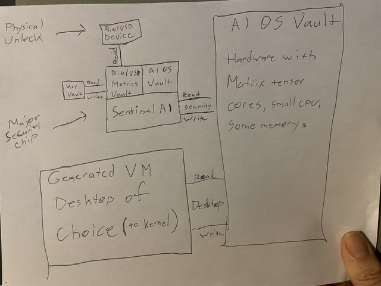

# OSAI: an AI-native operating system with hardware-separated authority

**A defensive technical disclosure.** Published so that what it describes is prior art: free for anyone to build, and
not patentable by anyone, including us.

- **Author:** Ian McClenathan (Brickmii), Cin-MinAI project lead
- **Conceived:** 2026-10-14 (the hand-drawn sketch below; the original photo of it, and the email that sent it
  to the author's computer, are kept with their timestamps)
- **Published:** 2026-10-25, in the public Cin-MinAI repository (the commit that adds this file)
- **Licence:** this text and its drawings are under
  [Creative Commons Attribution 4.0 International (CC BY 4.0)](https://creativecommons.org/licenses/by/4.0/). Code
  that implements any of it in the Cin-MinAI project is under the GPL-3.0, like the rest of the project.
- **Credits:** the design and the sketch are Ian's. ChatGPT helped write an early description and drew the clean
  redraw of the sketch; Claude (Anthropic) wrote this disclosure from both, with Ian. Each contributor is named plainly
  ([README, Credits](../../README.md#credits)).

**Status:** a proposed architecture. Parts of its software side exist today in Cin-MinAI (section 7). The dedicated
hardware, the full cryptographic protocol and the generated desktop are not built yet. Nothing here claims they are.

## Why this is published

> This is all for the community to try and help information stay free and flowing. The world was good to me with
> education. It's time to reciprocate and give back, and I have some powerful tools to help.
>
> — Ian

---

## 1. The idea in one paragraph

Today an AI assistant is a program inside an operating system that was designed without it, and when it is given
power over the computer it usually gets that power the same way a person does: an administrator account. OSAI turns
both of those around. **The AI builds and runs the user's computing environment** (the desktop, the programs, the
workflows), **while a separate, physically protected security system decides what anything, the AI included, is
allowed to do.** The owner's authority over the machine sits in a physical key that software cannot copy or grant
itself. And the security system is not only an AI that says yes or no: the functions the owner binds to the key run on
lanes that the key itself completes. **Without the key in, the circuit for a key-bound function is open, and it
physically cannot be performed,** by any software, however capable or privileged. The owner chooses which functions
are key-bound, and the security system rearranges its lanes to match. Intelligence is not ownership. Capability is not
permission. Autonomy is not administrative authority.

## 2. The original sketch

*The original, drawn by hand on 2026-10-14. A clean redraw of the same drawing: [osai-sketch-redraw.svg](osai-sketch-redraw.svg).*

What the sketch shows, as drawn:

- **Physical Unlock → Bio/USB Device.** The owner's physical key. It is *read* by the Bio/USB Metrics Vault.
- **The major security chip**, holding three parts side by side: the **Bio/USB Metrics Vault**, a small **AI OS Vault**
  link, and under them **Sentinel AI**. Beside it, the **Key Vault**, connected to the Metrics Vault by a *read* and a
  *write* path.
- **Sentinel AI** connects to the large **AI OS Vault** by three separate paths: **read**, **security** and **write**.
- **The AI OS Vault:** hardware with matrix/tensor cores, a small CPU and some memory.
- **The Generated VM: Desktop of Choice (to kernel)**, connected to the AI OS Vault by three separate paths: **read**,
  **desktop** and **write**.

The point of the drawing is that these are not programs sharing one set of permissions. They are separate trust
levels with separate, named paths between them.

## 3. The parts and what each is responsible for

| Part | Responsible for | Never responsible for |
|---|---|---|
| **Physical unlock device** (USB, with enrolled factors) | Proving the owner is present; the root of administrative authority | Anything else; it holds no general data |
| **Bio/USB Metrics Vault** | Reading the unlock device and checking the enrolled factors (biometric, voice phrase, PIN) against what was enrolled | Deciding what is allowed |
| **Key Vault** | Holding credentials and authorization material, non-exportable | Being read by ordinary software |
| **Sentinel** (a switch fabric with an AI beside it) | Opening and closing doors. Physically: routing each **key-bound function** onto a lane the key completes, and rearranging those lanes when the owner binds a new function. Beside that, granting, limiting, denying and revoking access to everything else, and isolating unknown AI processes | Building desktops, writing code, searching, chatting: it is deliberately narrow. Its AI part can never close a key-bound lane. Nothing inside the computer can update it: its firmware changes only through the key |
| **AI OS Vault** | The intelligence: generating and managing the user's environment, with its own tensor hardware, CPU and memory | Authority: it asks Sentinel like everything else |
| **Generated VM desktop** | Where the user works: a desktop the AI assembles for the user's chosen way of working | Reaching the vaults: it is a guest |

## 4. How it works

**Setup.** On first start the machine creates its owner credential inside the security chip and writes the matching
authorization to the physical unlock device, enrolling the chosen extra factors (a voice phrase, a PIN, a fingerprint).
The device can be **copied only on the machine that made it, while an existing copy is present.** There is no remote or
vendor recovery: lose every copy and protected administration is lost. This is deliberate. A recovery path is a
backdoor.

**Boot.** The security chip starts first and establishes the boundaries: what the AI OS Vault may touch, what the
desktop VM may touch, and what needs the owner. Only then does the AI OS Vault generate or restore the user's chosen
desktop inside its VM.

**Key-bound functions (what makes Sentinel more than an AI).** The owner can bind any function to the physical key:
a credential, a device, a kind of write, an administrative act. Sentinel then routes that function onto a **key-bound
lane**: a path in hardware that is complete only while the key is in. Without the key, the lane is open and the
circuit is incomplete. The function physically cannot be performed, not "is refused": there is nothing for software to
talk its way past. Sentinel **rearranges** itself to adapt: when the owner binds a new function (with the key in), it
assigns that function a key-bound lane; when they unbind one (with the key in), it releases it.

For example: the owner opens a new account and protects it with a special passkey, and chooses "bind to my key".
Sentinel puts the passkey in a keyring slot on a key-bound lane. From then on, signing in with that passkey needs the
key in the machine. Without it, the slot can't be read and the passkey can't sign, whatever is running, the AI
included. Pulling the key opens every key-bound lane at once, in hardware.

Sentinel has two parts, then: the **lanes**, which are physics and decide alone for what is key-bound, and an **AI
part**, which handles everything that isn't key-bound (the capability requests below, spotting unknown AI). The AI part
works only inside what the lanes allow. It can't close a key-bound lane or change which functions are bound.

**Everyday work.** Programs and AI models in the desktop request what they need: read this folder, use the camera, open
a network connection, install a package. Each request goes to Sentinel as a **capability request**: a specific action
on a specific resource for a specific time. Sentinel answers within the rules the owner set. A grant is narrow (read is
not write, write is not delete, inspecting hardware is not flashing firmware), bounded in time and revocable at once.

**Administration.** Changes to the protected layer (the security rules, the keys, firmware, the vaults themselves)
need the physical device present and its factors checked. **Removing the device revokes administrative authority
immediately.** No software, however capable, can grant itself what only the physical key grants.

**Unknown AI.** Every AI model that runs is registered: its file's cryptographic hash, who registered it, and what it
may do, signed by this machine's own key. A model the user trained locally is registered like any other, by the owner.
When Sentinel sees an AI process it can't identify (an unregistered model, a hash that changed, a process acting as a
model it isn't), it **cuts that process's access, isolates it, and records what it saw.** Anything destructive, like
deleting the model, waits for the owner. The goal is not to forbid unknown software. It is that unknown software never
silently gains authority.

**Sentinel's firmware is updated only through the key.** There is no internal way to update it: no path from the
host, the desktop, the AI or the network to Sentinel's firmware exists at all. Its write lane runs only through the
key, and that binding is permanent: unlike the functions the owner chooses, it can't be unbound. An update comes in on
the key itself. The owner puts the signed update on the key (on another machine, or at a public place such as a library
that offers the signed images), plugs the key in, and Sentinel's firmware is checked and written through the key's
lane. Nothing running on the computer, however capable, can change the gatekeeper.

**Updates happen at physical places, and the key carries the stamps.** The plan is to partner with **public
libraries** as update locations; other trusted places can be added, but every update has **physical accountability**.
The owner takes the key to a library's update station, which writes the signed update onto the key and adds a
**stamp**: which station, where, when, and which firmware version (with its hash), signed by that station. The stamps
live **on the key, not at the library**: the library keeps no record of who came in, and the owner carries the proof of
where they've been to update. Anyone can check a stamp against the stations' published keys, and if a station is ever
found compromised, every owner can see from their own stamps whether an update came from it.

**The desktop is replaceable; the security layer is not.** If the generated desktop breaks, or is compromised, it is
thrown away and generated again. The vaults and Sentinel are untouched.

## 5. Ways to build each part (the enabling detail)

This section is here so that the disclosure covers the *ways* to build OSAI, not only the idea. Each part can be built
in any of the ways listed, and in combinations of them.

### 5.1 The security chip (where Sentinel, the Metrics Vault and the Key Vault live)
- A discrete security processor on the motherboard or on a card, with its own firmware and memory, on a bus the host
  CPU cannot rewrite.
- A secure enclave or trusted execution environment inside the main processor (the "secure world" of a TrustZone-style
  design, a confidential-computing enclave).
- A TPM 2.0 for the keys and measurements, with Sentinel running in a hypervisor below the desktop VM.
- A separate small computer (a single-board computer, a microcontroller with a secure element) connected by USB or a
  dedicated link, acting as the gatekeeper for a host that boots only with its approval.
- A hardware security key (FIDO2 style) as the Key Vault itself.

### 5.2 Key-bound lanes: a function made physically impossible without the key
A key-bound lane is any path a function needs (power, an enable line, a data line, a secret) that is complete only
while the key is in. Ways to build one, alone or combined:
- **The key carries part of the circuit.** The lane runs out through the key's connector and back: a loop-through path,
  a jumper or a component inside the key. Without the key, the lane is physically broken.
- **A hardware switch driven only by the key.** An analog switch, a transistor or a relay on the lane, whose control
  signal comes from a fixed hardware circuit that turns it on only while the key is present and has answered its
  challenge. No processor, and so no software, drives that signal.
- **A cryptographic open circuit.** The function needs a secret split in two: one share in the Key Vault, the other only
  in the key. Neither share alone can do anything, so without the key the operation can't be computed.
- **Both together:** the key's share travels only on a lane that is physically broken without the key.
- **Gating what the function needs:** the chip-select, write-enable or power line of a memory region (a keyring slot,
  the firmware flash, the boot settings, an encryption key's store), the power of a device (camera, microphone, radio),
  the link to a network interface, or an accelerator's connection.

**Rearranging the lanes (how the owner assigns functions).** Between the protected resources and the key's lanes sits
a reconfigurable interconnect: a crossbar switch matrix, a programmable logic fabric (FPGA style), or a bank of switches
with a routing table. Binding a function to the key writes that routing; unbinding removes it. **The routing table is
itself on a key-bound lane:** it can only be changed with the key in, so nothing can unbind a function while the key is
away. Variants: a fixed number of lanes the owner fills (like slots); lanes per kind of resource (all keyring slots,
all firmware, each device); or a hierarchy, where one key-bound lane gates a whole group.

**What can be bound, as examples:** a passkey or account credential in the keyring; a disk or an encryption key; firmware
and boot settings; the camera, the microphone, the radios; a cryptocurrency wallet's signing key; administrative acts;
the AI's access to the network or to a given folder; model registration; Sentinel's own configuration.

**Removing the key** opens every key-bound lane at once, by hardware: no polling, no message, no software involved.

**Sentinel's own firmware is permanently key-bound,** and through the key only. Its flash chip's write-enable (and its
data path for writing) is wired out through the key's connector; there is no other write path on the board, and no
bootloader or update service inside the computer that could write it. Ways to bring an update in:
- the signed image is stored on the key (a storage area in the key, written on another machine or at a public kiosk),
  and Sentinel's fixed boot circuit checks its signature and writes it through the key's lane while the key is in;
- the key itself holds the programmer: a small circuit in the key writes Sentinel's flash directly, over the lane only
  the key completes;
- a variant with two keys: the update image on one stick, the owner's key in as well to authorise it.
In every variant, an update can be rolled back only by the same path, and a version counter on the key-bound side
refuses an older image unless the owner, with the key in, asks for it.

**Update stations and stamps (physical accountability):**
- **Stations at partner libraries** (and other trusted public places): a kiosk with the signed firmware images and its
  own **station signing key**, held in a hardware security module in the kiosk. The stations' public keys are
  published, with a revocation list.
- **The stamp:** a signed record written onto the key at each update: the station's identity and place, the date and
  time, the firmware version and the image's hash, signed by the station. Each stamp also holds the hash of the stamp
  before it, so the stamps form a **chain**: one can't be removed or reordered without it showing.
- **Kept on the key only.** The station keeps no record of the owner or the key (no account, no name, no key serial);
  it may keep an anonymous count of updates given. The owner holds the proof and decides whom to show it.
- **Sentinel checks the stamp** before applying firmware: a valid station signature, a version newer than the one
  installed, the chain intact. A firmware without a valid stamp is refused, unless the owner chooses otherwise with the
  key in (a person building their own firmware, recorded as a **self-stamp** that says so).
- **Revocation:** if a station is found compromised, its key goes on the revocation list; Sentinel and the owner can see
  which installed updates came from it, and the owner can go back to a version stamped elsewhere.
- **A physical stamp too**, as a variant: a printed or ink stamp in a small booklet that goes with the key, an "update
  passport", for owners who want a record they can hold.

### 5.3 Everything that isn't key-bound: how Sentinel's other decisions are enforced
A gatekeeper that only says yes or no in conversation enforces nothing. For what isn't key-bound, Sentinel's answers
have to control real mechanisms:
- **The hypervisor:** the desktop VM gets only the devices, disk areas and network paths Sentinel grants; grants and
  revocations are hot-plug and unplug of virtual devices, mounts and network rules.
- **The IOMMU** (the hardware that limits which device may reach which memory): a device or accelerator is mapped into
  the VM's memory only while granted.
- **Capability tokens:** a grant is a signed, short-lived token naming the action, the resource and the expiry; the
  file system, the device drivers and the network check the token, not the caller's identity. Revocation is a
  revocation list, or keys that rotate so old tokens stop working.
- **Kernel mandatory access control** (an SELinux, AppArmor or Landlock policy, or seccomp filters) that only the
  security chip can change.
- **Per-request administrator approval** for anything that changes the system, as a policy that needs the physical
  device to be present.
- Sentinel itself may be a **fixed rule engine**, a **small model kept for classifying** requests (whose output only
  selects from rules the owner wrote, never invents a grant), or both: rules decide, the model only spots the unusual.

### 5.4 The physical unlock and its factors
- A USB key with a non-exportable private key (a secure element): the machine sends a challenge, the key signs it.
- The extra factors (fingerprint, a spoken phrase, a PIN) are checked **on the device or in the Metrics Vault**, never
  by the desktop. A voice can be imitated, so a voice phrase is never the only factor for administration.
- Copying a key: the machine and an existing key together enrol a new key; the machine records every key it enrolled
  and can revoke any of them. Without an existing key, no new key can be enrolled.
- Presence: administration lasts only while the device is plugged in (or, a variant, within a short time window after
  a tap), and ends the moment it is removed.

### 5.5 The Authenticator (credentials that are never the same twice)
- Credentials never leave the security chip; software receives proofs, not keys.
- Each use advances the protected state: a **monotonic counter** in hardware plus a **forward-secure key ratchet**
  (each key derived one-way from the last, the old one erased), so a stolen proof can't be replayed and a stolen
  current state can't reveal the past.
- Rollback protection: the counter can only go up; a state restored from a backup with a lower counter is refused.
- Clone detection: two devices presenting the same counter value means one is a copy; both are suspended until the
  owner decides.
- Resynchronisation after a lost message: a bounded look-ahead window, never a reset to an old state.

### 5.6 Model registration
- A **signed manifest** for each model: its hash (SHA-256 or stronger), its name, its source, who registered it and
  what it may do, signed by this machine's key in the security chip.
- **Measured loading:** the model loader hashes the file as it loads it and asks Sentinel; a mismatch means the model
  is treated as unknown.
- Models the owner trains or fine-tunes are registered by the owner with the physical device present.
- A variant: manifests from publishers (signed by them) can be trusted as far as the owner chooses, but this machine's
  own signature is what lets a model run here.

### 5.7 The AI OS Vault (the intelligence hardware)
- A PCIe accelerator card with tensor cores, a small CPU and memory of its own.
- An external accelerator over USB4 or Thunderbolt.
- The GPU the computer already has, with the AI's memory mapped only to the AI's processes through the IOMMU.
- A neural processing unit inside the main processor.
- A separate computer on the local network.
- In every variant the AI OS Vault is a **requester**: it can generate and propose, and the security chip decides.

### 5.8 The generated desktop
- The user chooses how they work ("a programming workstation", "a car diagnostics bench", "a family desktop", or their
  own words), and the AI turns that into a **declarative description**: the programs, the layout, the files and devices
  it needs, the permissions it will ask for.
- The description is built into a VM image (or a container, or an immutable system image with layers), started under
  the hypervisor, and kept so it can be restored at the next boot or rebuilt from the description.
- The permissions the description asks for are requested from Sentinel when the desktop starts, not assumed.
- The desktop can be thrown away and generated again at any time; the user's files live outside it, in storage that
  Sentinel grants to it.
- "To kernel" in the sketch is the long-term direction: the AI taking part ever deeper in the system (choosing and
  configuring kernel modules, eventually generating parts of the system itself) while the security chip stays separate.
  A conventional Linux kernel with a hypervisor is the practical start.

## 6. What it builds on

Most parts exist on their own. What is described here is how they are put together: an AI that generates and runs the
user's environment, a gatekeeper the AI cannot control, physical ownership as the root of authority, and the rule that
the AI is never the authority, and above all **key-bound lanes the owner assigns**: functions the owner chooses are
routed, by a reconfigurable fabric, onto paths that only the physical key completes.
- **Hardware kill switches** (Purism's Librem laptops and phone: camera, microphone, radios), **write-protect jumpers**
  on firmware chips, and a security key's **touch to confirm**: fixed physical gates. Here the gates are assignable by
  the owner, and the hardware rearranges to match.
- **TPM 2.0, secure enclaves, secure elements:** hardware key storage and measured boot.
- **FIDO2 / WebAuthn security keys:** a physical, non-exportable credential.
- **Qubes OS:** desktops split into isolated VMs, with a privileged domain underneath.
- **Capability-based systems** (seL4, Capsicum, Fuchsia's handles): access as narrow, unforgeable grants.
- **polkit and sudo:** per-action administrator approval on Linux.
- **Mandatory access control** (SELinux, AppArmor, Landlock).

## 7. What already runs in Cin-MinAI

[Cin-MinAI](https://github.com/Cin-MinAI/Cin-MinAI), the Linux Mint derivative with a local AI assistant this disclosure
comes from, already does the software side of several parts:
- **The AI is never the administrator** (PLAN D85). Every administrative action goes through one root mechanism on
  D-Bus and asks for the owner's password through polkit, each time.
- **The AI's commands run sandboxed** (bubblewrap, a private network), with the person's keys walled off.
- **Releases are signed with a physical key stick** (PLAN D72): signing needs the device in hand.
- **Cloud API keys live in the desktop's keyring,** never in the AI's reach.
- **Permission modes** the person chooses (ask, auto for reversible actions, irreversible actions always ask).
- **Several AI models at one table** (Team Table): local and cloud models working as members, each recorded.

## 8. Open questions (said plainly)

- How the security chip, the AI OS Vault and the host talk: an authenticated channel ordinary host software cannot
  reach.
- A formal specification of the Authenticator protocol, and a proof of its resistance to replay, rollback, cloning and
  loss of synchronisation.
- The PIN's exact role: it may help the device authenticate the owner; it must never replace a lost device.
- Isolation strong enough that a compromised desktop cannot reach the vaults even though the AI generated that desktop.
- Who signs Sentinel's firmware updates, and how a person checks one on the key before plugging it in.
- The library partnership: how stations are set up and kept, who holds the station keys and the revocation list,
  and what a library may record (an anonymous count, nothing about the owner).
- How many key-bound lanes a machine has and how finely they divide (a lane per keyring slot, or one per group), and
  how quickly the fabric rearranges when a function is bound.

These are what a working prototype has to show. They are not reasons to give up on the design.

## 9. How to cite

Ian McClenathan (Brickmii), *OSAI: an AI-native operating system with hardware-separated authority*, Cin-MinAI project, 2026-10-25.
https://github.com/Cin-MinAI/Cin-MinAI/tree/main/docs/osai (CC BY 4.0)
